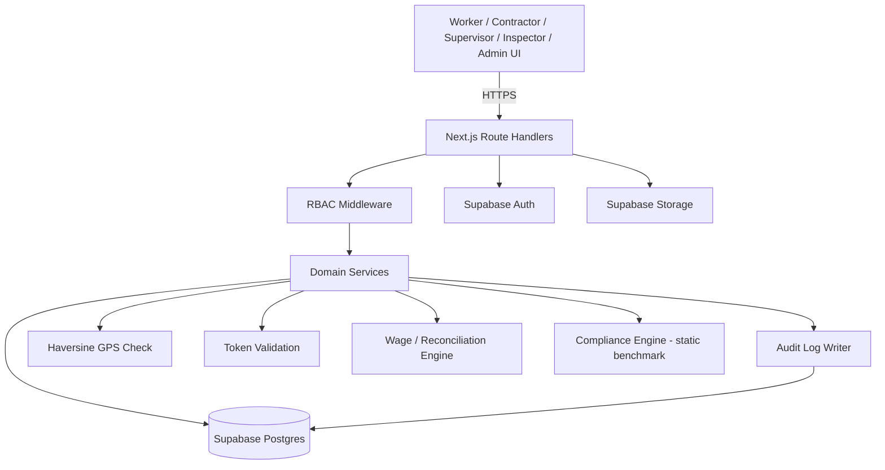

# ShramikSetu — Implementation Guide

This document explains **how** the PRD.md MVP is built. It is not a product document — if something here isn't backed by an approved PRD feature, it shouldn't be built (see AGENTS.md).

## 1. Implementation Overview

Single Next.js full-stack app (web, PWA-installable), Supabase for Postgres + Auth + Storage, deployed as one repo/monorepo-lite. No native mobile app in Semester 1 (see PRD Decision Log #2).

## 2. Technology Stack

| Layer | Choice |
|---|---|
| Frontend | Next.js 14 (App Router), React, TypeScript, Tailwind CSS, shadcn/ui |
| Backend | Next.js Route Handlers (API), Node.js runtime |
| Database | Supabase PostgreSQL |
| Auth | Supabase Auth (mobile OTP + email fallback for testing) |
| Storage | Supabase Storage (profile photos, PDF passports) |
| QR | `qrcode` (generation) + browser camera API / `html5-qrcode` (scanning) |
| Location | Browser Geolocation API |
| PDF | `@react-pdf/renderer` or server-side PDF generation for Employment Passport |
| i18n | `next-intl` or static JSON dictionaries per locale (`en`, `hi`, `mr`) |
| Hosting | Vercel (app) + Supabase (data) — both free-tier compatible |

## 3. System Architecture

Client (Next.js pages, role-scoped) → Next.js Route Handlers (API layer, RBAC-checked) → Supabase Postgres (source of truth) + Supabase Auth (identity) + Supabase Storage (files).

All writes to financial/attendance state go through server-side route handlers that re-validate role, ownership, GPS, and token — the client never writes wallet balances, wage amounts, or compliance status directly.

## 4. Architecture Diagram (Mermaid)



## 5. Frontend Architecture

Role-based route groups: `/worker/*`, `/contractor/*`, `/supervisor/*`, `/inspector/*`, `/admin/*`. Shared components (contract card, wallet ledger, dispute timeline) live in `components/`. All user-facing strings pulled from i18n dictionaries — no hardcoded copy.

## 6. Backend Architecture

Route handlers grouped by domain (`/api/contracts`, `/api/attendance`, `/api/wallet`, `/api/payments`, `/api/disputes`, `/api/compliance`, `/api/passport`). Each handler: authenticate → authorize (role + ownership) → validate input → execute domain logic → write audit event → respond.

## 7. Database Architecture

Supabase Postgres, normalized schema (Section 25), Row-Level Security policies as a second enforcement layer behind API-level RBAC.

## 8. Authentication Architecture

Supabase Auth with phone OTP as primary method (email/password as a dev-environment fallback). Session JWT carries `user_id`; role is looked up server-side from the `users` table on every request — role is never trusted from the client/JWT claim alone in MVP to keep RBAC simple and auditable.

## 9. RBAC Implementation

Central `requireRole(handler, allowedRoles[])` wrapper around every route handler. Ownership checks (e.g., "is this worker the subject of this contract?") happen inside the handler after the role check.

## 10. QR Implementation

QR encodes an opaque `contract_join_token` (random UUID), not contract details. Backend resolves the token to a contract, checks status/expiry, and only then returns contract data to the scanning client.

## 11. GPS Geofencing Implementation

At attendance time: browser requests device geolocation → client sends `{lat, lng, token}` to `/api/attendance/mark` → server fetches worksite `{lat, lng, radius_m}` → runs Haversine → accepts only if `distance <= radius_m` and token is valid/unexpired/unused.

## 12. Haversine Calculation

```
a = sin²(Δlat/2) + cos(lat1)·cos(lat2)·sin²(Δlng/2)
c = 2·atan2(√a, √(1−a))
distance = R·c   (R = 6371000 metres)
```
Computed server-side only, in the attendance route handler — never trusted from client-calculated distance.

## 13. Attendance Token Implementation

Supervisor calls `/api/attendance/token/create` for a project → server generates a random token with a short TTL (e.g., 10–15 minutes) tied to `project_id` → stored in `attendance_tokens` with `used_by[]` tracking to block replay by the same worker within its validity window. Token + GPS are both required to mark attendance.

## 14. Wage Calculation

`expected_earnings = verified_workdays × contract.daily_wage` (overtime rule applied if the contract defines one). Computed server-side, triggered whenever an attendance event is verified; writes an `earnings_records` row.

## 15. Digital Wage Wallet Implementation

Every balance-changing action (wage verified, payment recorded, adjustment, refund) creates one `wallet_transactions` row with a type from `{WAGE_CREDIT, PAYMENT_RECEIVED, ADJUSTMENT, REFUND}`. Displayed balance is always `SUM(wallet_transactions.amount)` for that worker — never a separately-stored mutable field — so it cannot drift from its own history.

## 16. Payment Reconciliation

`outstanding_amount = expected_earnings − SUM(confirmed payment amounts)`. Recomputed on read (not cached) to guarantee consistency; a background/query-time job flags `outstanding_amount > 0` older than a threshold for the Inspector dashboard.

## 17. Dispute Implementation

`disputes` table linked to the relevant contract/attendance/payment record. On creation, server assembles an evidence timeline by querying contract, contract_versions, attendance_events, earnings_records, wallet_transactions in `event_time` order and snapshots it into `dispute_evidence` (append-only) so the evidence doesn't change if later events occur.

## 18. Employment Passport

Read-only aggregation view across a worker's contracts/attendance/earnings/payments; rendered in-app and, where time allows, exported via a server-side PDF render endpoint.

## 19. Multilingual/i18n Implementation

Static JSON dictionaries per locale in `locales/{en,hi,mr}/*.json`; locale stored on the user profile and in a cookie; all worker/contractor-facing components import strings via the i18n hook — no inline literals.

## 20. Notifications

In-app `notifications` table, polled or fetched on page load; no external SMS/email provider integration in Semester 1.

## 21. Audit Logging

Every domain service call that changes state writes one `audit_events` row (`actor_id`, `action`, `entity_type`, `entity_id`, `before/after snapshot`, `timestamp`). Rows are insert-only; no update/delete endpoint exists for this table (this is what makes the trail "tamper-evident," not a blockchain claim).

## 22. Security

Server-side RBAC + Supabase RLS, parameterized queries (Supabase client handles this), secrets via environment variables, no wage/wallet/compliance field ever accepted as a direct client write — always derived.

## 23. Privacy

GPS coordinates stored only on the specific `attendance_events` row they verify, with no separate location-history table and no map/trail UI. Worker financial data is scoped to that worker, their contractor(s) on shared contracts, and Inspectors on escalated disputes only.

## 24. API Structure (representative endpoints)

| Method | Endpoint | Purpose | Auth | Role | Request | Response | Errors |
|---|---|---|---|---|---|---|---|
| POST | /api/auth/otp/verify | Verify OTP, create session | Public | Any | `{phone, otp}` | `{session, user}` | 400 invalid OTP |
| POST | /api/projects | Create project/worksite | Session | Contractor | `{name, lat, lng, radius_m, dates}` | `{project}` | 403 wrong role |
| POST | /api/contracts | Create digital contract | Session | Contractor | `{worker_id, project_id, wage, dates}` | `{contract, join_token}` | 400 invalid worker |
| POST | /api/contracts/{id}/respond | Accept/reject contract | Session | Worker | `{decision}` | `{contract}` | 409 already responded |
| POST | /api/attendance/token | Issue attendance token | Session | Supervisor | `{project_id}` | `{token, expires_at}` | 403 not assigned |
| POST | /api/attendance/mark | Mark attendance | Session | Worker | `{token, lat, lng}` | `{attendance_event}` | 422 out of radius / expired token |
| GET | /api/wallet/{worker_id} | Get wallet + transactions | Session | Worker/Contractor(scoped) | — | `{balance, transactions[]}` | 403 not owner |
| POST | /api/payments | Record payment | Session | Contractor | `{worker_id, contract_id, amount, mode}` | `{payment, transaction}` | 400 exceeds outstanding (warn, not block) |
| POST | /api/payments/{id}/confirm | Worker confirms/disputes payment | Session | Worker | `{decision}` | `{payment}` | 404 not found |
| GET | /api/reconciliation/{contract_id} | Expected/paid/outstanding | Session | Worker/Contractor/Inspector | — | `{expected, paid, outstanding}` | — |
| POST | /api/disputes | Raise dispute | Session | Worker | `{ref_type, ref_id, reason}` | `{dispute, evidence_timeline}` | 400 no linked record |
| GET | /api/compliance/{contract_id} | Compliance indicator | Session | Any scoped role | — | `{status, benchmark_used}` | 204 insufficient data |
| GET | /api/passport/{worker_id} | Employment passport | Session | Worker/Inspector | — | `{passport}` / PDF | 403 not authorized |
| GET | /api/dashboard/inspector | Aggregate dashboard data | Session | Inspector | — | `{aggregates}` | — |

## 25. Database Schema

| Table | Purpose | Key Columns | Relationships |
|---|---|---|---|
| users | Account + role | id, phone, role, locale | 1—1 with workers/contractors/supervisors/admins |
| workers | Worker profile | id, user_id, name, occupation, skill_category, internal_worker_id | → users |
| contractors | Contractor profile | id, user_id, org_name | → users |
| supervisors | Supervisor profile | id, user_id, assigned_project_ids | → users, projects |
| projects | Worksite/project | id, contractor_id, name, lat, lng, radius_m, start_date, end_date | → contractors |
| work_contracts | Digital contract | id, worker_id, contractor_id, project_id, daily_wage, overtime_rule, payment_frequency, status | → workers, contractors, projects |
| contract_versions | Version history | id, contract_id, version_no, changed_fields, snapshot, created_at | → work_contracts |
| attendance_tokens | Short-lived tokens | id, project_id, token, expires_at, used_by[] | → projects |
| attendance_events | Verified attendance | id, worker_id, contract_id, project_id, date, lat, lng, distance_m, token_id, status | → workers, contracts, projects, tokens |
| earnings_records | Calculated earnings | id, contract_id, verified_days, daily_wage, expected_amount | → work_contracts |
| wallet_transactions | Ledger entries | id, worker_id, type, amount, ref_type, ref_id, created_at | → workers |
| payment_records | Recorded payments | id, contract_id, worker_id, amount, mode, status (recorded/confirmed/disputed) | → work_contracts |
| disputes | Dispute cases | id, raised_by, ref_type, ref_id, status, created_at | → workers, contracts/attendance/payments |
| dispute_evidence | Snapshot timeline | id, dispute_id, event_summary_json, created_at | → disputes |
| minimum_wage_benchmarks | Static compliance reference | id, state, zone, trade, min_daily_wage | — |
| compliance_checks | Computed indicator | id, contract_id, status, benchmark_id, checked_at | → work_contracts, minimum_wage_benchmarks |
| audit_events | Insert-only audit trail | id, actor_id, action, entity_type, entity_id, before, after, created_at | polymorphic |
| notifications | In-app notices | id, user_id, message, read, created_at | → users |

**Indexes:** `attendance_events(worker_id, date)` unique-ish constraint to block duplicate same-day attendance; `wallet_transactions(worker_id)`; `attendance_tokens(token)` unique.

## 26. Important Data Relationships

Contract → Attendance → Earnings → Wallet Transactions → Payments → Reconciliation → Disputes → Audit Events. Every downstream record references its upstream cause; nothing is entered independently of this chain.

## 27. Error Handling

Consistent JSON error shape `{error: {code, message}}`; 4xx for validation/authorization, 5xx logged server-side with request id. GPS/token failures return 422 with a specific reason (`OUT_OF_RADIUS`, `TOKEN_EXPIRED`, `TOKEN_ALREADY_USED`).

## 28. Validation

Server-side schema validation (e.g., `zod`) on every route handler input; client-side validation is UX-only and never trusted.

## 29. Testing

Unit tests for Haversine, wage calculation, and reconciliation math (pure functions — highest-value tests for this domain). Integration tests for the attendance-mark and payment-record endpoints (happy path + rejection cases). Manual QA script for the full demo journey before Week 12.

## 30. Deployment

Vercel for the Next.js app; Supabase managed Postgres/Auth/Storage. Single `main` branch auto-deploys to a staging URL; a tagged release deploys to the demo environment.

## 31. Environment Variables

`NEXT_PUBLIC_SUPABASE_URL`, `NEXT_PUBLIC_SUPABASE_ANON_KEY`, `SUPABASE_SERVICE_ROLE_KEY` (server-only), `NEXTAUTH_SECRET`/session secret if used alongside Supabase Auth.

## 32. Local Development Setup

1. `npm install`
2. Copy `.env.example` → `.env.local`, fill Supabase project keys.
3. `npx supabase db push` (or run migration SQL) to create schema + seed `minimum_wage_benchmarks`.
4. `npm run dev`.

## 33. Production Deployment

Not a Semester 1 target beyond a stable demo deployment on Vercel; no production SLA claims.

## 34. Monitoring

Vercel logs + Supabase dashboard for query/error monitoring during the semester; no dedicated observability stack in MVP.

## 35. Backup/Recovery

Rely on Supabase's managed automatic backups (free-tier limits documented, not guaranteed) — sufficient for a student project; not a production guarantee.

## 36. Future Extensibility

Schema and route structure intentionally leave room for: an `offline_sync_queue` table (Future Scope #1), a `mobile_devices` table for a future React Native app, additional `minimum_wage_benchmarks` rows per state/trade without schema change, and a `payment_gateway_ref` column addition to `payment_records` when real payments are introduced — none of these require restructuring existing tables.

## Suggested Repository Structure

```
shramiksetu/
├── app/
│   ├── worker/
│   ├── contractor/
│   ├── supervisor/
│   ├── inspector/
│   ├── admin/
│   └── api/
│       ├── auth/
│       ├── projects/
│       ├── contracts/
│       ├── attendance/
│       ├── wallet/
│       ├── payments/
│       ├── disputes/
│       ├── compliance/
│       └── passport/
├── components/
├── lib/
│   ├── supabase/
│   ├── auth/
│   ├── qr/
│   ├── geolocation/
│   ├── wage/
│   ├── reconciliation/
│   └── audit/
├── locales/
│   ├── en/
│   ├── hi/
│   └── mr/
├── database/
│   ├── migrations/
│   ├── policies/
│   └── seed/
└── docs/
    ├── PRD.md
    ├── IMPLEMENTATION.md
    ├── PROGRESS.md
    └── AGENTS.md
```