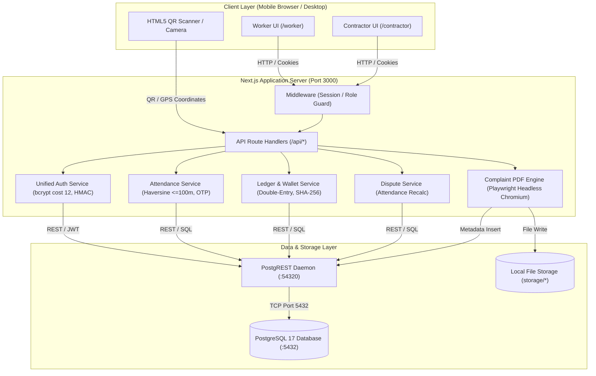

# PROJECT_TECH_AND_LOGIC.md
**ShramikSetu: Technical Architecture, Logic & Verification Reference**
*Authoritative Documentation for Technical Review & Viva Defense*

---

## 1. Tech Stack Table

| Layer | Technology | Version | Where Used (File Paths) | Why It Is Used |
| :--- | :--- | :--- | :--- | :--- |
| **Frontend Framework & Router** | Next.js (App Router) | `14.2.35` | `src/app/**`, `src/app/layout.tsx`, `next.config.mjs` | Server-Side Rendering (SSR), React Server Components, file-based routing, and built-in API route handlers. |
| **UI Library & React Core** | React / React-DOM | `18.3.1` | `package.json`, `src/components/**`, `src/app/**` | Component-based interactive UI with concurrent rendering and hooks. |
| **State Management** | React Context & Hooks | `18.3.1` | `src/lib/auth-context.tsx`, `src/app/**/page.tsx` | Centralized session, authentication, language state (`AuthProvider`), and local component state. |
| **Styling & Design System** | Tailwind CSS / PostCSS / Autoprefixer | `3.4.19` / `8.5.28` / `10.6.1` | `tailwind.config.ts`, `postcss.config.js`, `src/app/globals.css` | Neo-brutalist high-contrast design system (`shadow-brutal`, `border-black`), statutory typography, responsive utility layout. |
| **Internationalization (i18n)** | Custom Tri-Lingual Engine (EN / HI / MR) | Custom (`1.0.0`) | `src/locales/index.ts`, `src/lib/auth-context.tsx`, `scripts/audit-i18n.ts` | Complete parity across English, Hindi, and Marathi; persists in cookies & `localStorage`; verified by automated key parity audit. |
| **QR Code Scanner** | html5-qrcode & jsQR | `2.3.8` & `1.4.0` | `src/components/ui/QrScannerModal.tsx`, `src/app/worker/attendance/page.tsx` | In-browser camera QR video stream scanning and fallback image pixel decoding. |
| **QR Code Generator** | qrcode | `1.5.4` | `src/lib/crypto/qr-token.ts`, `src/lib/services/complaint-report-service.ts`, `src/components/ui/QrGeneratorModal.tsx` | Generates 2D QR matrix SVG/DataURLs for rotating attendance tokens and dispute verification links. |
| **PDF Generation Engine** | Playwright Core (Headless Chromium) | `1.63.0` | `src/lib/services/complaint-report-service.ts#L1326-L1385`, `next.config.mjs` | Full headless Chromium rendering of HTML to A4 PDF; preserves Devanagari complex script conjuncts and matras without glyph breaking. |
| **Chromium Protocol Helper** | chromium-bidi | `157.0.8093-0` | `next.config.mjs`, `package.json` | BiDi protocol support for headless Chromium automation. |
| **PDF Verification & Parsing** | pdf-parse | `2.4.5` | `scripts/verify-report.ts#L24`, `scripts/verify-disputes.ts` | Extracts Unicode text streams from generated PDFs to verify zero tofu (`U+FFFD`) and ensure font embedding. |
| **Local Bundled Fonts** | @fontsource/noto-sans & @fontsource/noto-sans-devanagari | `5.3.0` & `5.3.0` | `src/lib/services/complaint-report-service.ts#L430-L460`, `package.json` | Fully offline embedded TrueType fonts for Hindi and Marathi Devanagari script; eliminates CDN dependency. |
| **Backend Runtime** | Node.js (Windows x64) | `v24.14.0` | Server runtime for Next.js and automation scripts | Asynchronous event-driven JavaScript/TypeScript execution runtime. |
| **Backend API Framework** | Next.js API Route Handlers | `14.2.35` | `src/app/api/**/route.ts` | RESTful endpoints for contracts, attendance, wallet, disputes, reports, and compliance. |
| **Database** | PostgreSQL | `17.x` | Port `5432` (`localhost:5432/shramiksetu`) | Relational ACID database with strict schemas, foreign keys, and integer paise monetary columns. |
| **Database REST Daemon** | PostgREST | `v12.x` | `bin/postgrest.exe`, `supabase/postgrest.conf` (Port `54320`) | Generates secure high-performance HTTP REST API directly from PostgreSQL schemas. |
| **Database Client / ORM** | @supabase/supabase-js & @supabase/ssr | `2.112.3` & `0.5.2` | `src/lib/supabase/client.ts`, `server.ts`, `admin.ts` | Query builder and client interface connecting Next.js server and client to PostgREST/PostgreSQL. |
| **Authentication & Encryption** | bcryptjs & Node crypto | `3.0.3` & Native | `src/lib/auth/unified-auth.ts`, `src/lib/crypto/qr-token.ts` | Cost-12 bcrypt password hashing, constant-time dummy comparisons, HMAC-SHA256 cookie signing, AES-256-GCM token storage. |
| **Schema Validation** | zod | `3.25.76` | `src/lib/validations/**`, `src/app/api/**` | Runtime request body schema validation and type inference. |
| **File Storage** | Local Filesystem Storage | Native `fs` | `storage/complaint-reports/`, `storage/dispute-evidence/` | Persistent storage for tamper-evident complaint report PDFs and dispute evidence artifacts. |
| **End-to-End & Smoke Testing** | @playwright/test | `1.63.0` | `playwright.config.ts`, `tests/**`, `scripts/smoke-*.ts` | Automated browser testing across mobile viewports (375px/390px) and desktop. |
| **Unit Testing Framework** | vitest | `4.1.11` | `vitest.config.ts`, `tests/**/*.test.ts` | Fast unit test runner for cryptographic services, ledger math, and compliance logic. |
| **Dev Tooling & HTTPS Tunnel** | localtunnel & tsx | `localtunnel` CLI & `tsx` | `scripts/mobile-tunnel.ts`, `task-11043` | Exposes local development port 3000 to public HTTPS (`https://fast-hands-see.loca.lt`) for testing on physical mobile phones. |
| **Environment & Configuration** | dotenv / next.config.mjs | Native | `.env.local`, `next.config.mjs`, `tsconfig.json` | Server environment variables, database keys, and Webpack server component externalization. |

---

## 2. Architecture and Data Flow

### Architecture Diagram



### Contractor Flow
The contractor signs in at `/signin?role=contractor` using their sequential ID (e.g. `SS-C-2026-000001`) and bcrypt password (`src/app/api/auth/signin/route.ts#L20-L75`). The contractor creates projects with GPS worksite coordinates (`src/app/contractor/projects/new/page.tsx`). To hire, the contractor issues a contract offer specifying the worker ID, trade, and daily wage in paise (`src/app/contractor/projects/[id]/contracts/new/page.tsx#L160-L240`). The system validates the daily wage against statutory minimum wages; if under statutory minimum, a warning modal mandates statutory override acknowledgment (`src/lib/compliance/statutory-wages.ts#L92`). Each morning, the contractor opens `/contractor/projects/[id]` which calls `src/lib/services/attendance-service.ts#L105` to generate a rotating HMAC-SHA256 signed QR token and a 6-digit backup code valid only for that IST date. Once attendance is recorded, the contractor can confirm payments via `/contractor/projects/[id]/payments` which creates double-entry ledger records.

### Worker Flow
The worker signs in at `/signin?role=worker` using their ID (e.g. `SS-W-2026-000001`) and password (`src/app/worker/page.tsx`). The worker views pending contracts in `/worker/contracts`, reviewing daily wage rates juxtaposed against statutory minimums with visual compliance badges (`src/app/worker/contracts/page.tsx#L185-L250`). Upon accepting, the contract status transitions to `ACCEPTED`/`ACTIVE` (`src/app/api/contracts/[id]/accept/route.ts`). At the worksite, the worker scans the contractor's rotating QR code or inputs the 6-digit code via `/worker/attendance` (`src/lib/services/attendance-service.ts#L160`). The server verifies the token signature, date, and Haversine distance (`<= 100m`). Upon successful punch, the system automatically creates a `WAGE_ACCRUAL` double-entry ledger entry. The worker views accumulated earnings in `/worker/wallet`, can trigger sandbox withdrawals, and if underpaid, files a dispute via `/worker/disputes` and downloads an authoritative, tamper-evident statutory complaint PDF (`src/lib/services/complaint-report-service.ts#L1345`).

### State of Runtime Data (Hard Facts)
- **JSON files**: Runtime API endpoints **DO NOT** serve business data from static JSON files. All contracts, attendance events, users, wallets, disputes, and audit logs are queried live from PostgreSQL tables via PostgREST. `data/minimum_wages.csv` is used only as an offline benchmark and fallback in `src/lib/compliance/statutory-wages.ts#L155`.
- **In-Memory**: In-memory maps exist strictly for transient rate-limiting and browser management:
  1. `rateLimitMap` in `src/app/api/disputes/[id]/report.pdf/route.ts#L7` (10 requests/minute per client).
  2. `otpAttemptTracker` in `src/lib/services/attendance-service.ts#L90` (5 failed OTP attempts -> 15 min lockout).
  3. `authRateLimiter` in `src/lib/auth/unified-auth.ts#L70` (5 failed logins -> 15 min lockout).
  4. `sharedBrowser` in `src/lib/services/complaint-report-service.ts#L1328` (browser instance caching).
- **LocalStorage**: Used on the client side strictly for:
  1. `shramiksetu_locale`: user language preference (`'en' | 'hi' | 'mr'`).
  2. `shramiksetu_cached_balance`, `shramiksetu_cached_attendance`, `shramiksetu_cached_contracts`: offline cache for display when the mobile device loses network connectivity (`src/lib/offline-cache.ts#L30-L120`).

---

## 3. Database Schema

The database consists of **45 tables** in the `public` schema in PostgreSQL 17:

| Table Name | Primary Key | Foreign Keys (Column -> Foreign Table.Column) | Row Count | Summary of Key Columns |
| :--- | :--- | :--- | :--- | :--- |
| **`accounts`** | `id` (uuid) | None | 58 | `account_type`, `owner_id`, `code`, `name`, `currency`, `is_active` |
| **`anchors`** | `id` (uuid) | None | 0 | `anchor_date`, `merkle_root`, `ledger_entries_count`, `attendance_events_count`, `published_to_external` |
| **`attendance_discrepancies`** | `id` (uuid) | `contract_id -> work_contracts.id`, `project_id -> projects.id`, `worker_id -> workers.id` | 0 | `date`, `conflict_type`, `worker_claim` (jsonb), `contractor_record` (jsonb), `status` |
| **`attendance_events`** | `id` (uuid) | `contract_id -> work_contracts.id`, `contractor_id -> contractors.id`, `project_id -> projects.id`, `worker_id -> workers.id`, `worksite_id -> worksites.id` | 1346 | `date`, `worker_latitude`, `worker_longitude`, `calculated_distance_meters`, `allowed_radius_meters`, `status` (`VERIFIED`/`FLAGGED`), `verification_method`, `flags` (jsonb) |
| **`attendance_summaries`** | `id` (uuid) | `contract_id -> work_contracts.id`, `project_id -> projects.id`, `worker_id -> workers.id` | 0 | `period_start`, `period_end`, `verified_days_count`, `total_amount_paise`, `status` |
| **`attendance_tokens`** | `id` (uuid) | `project_id -> projects.id`, `worksite_id -> worksites.id` | 2 | `token_hash`, `short_code_hash`, `date_ist`, `expires_at`, `encrypted_payload` |
| **`audit_events`** | `id` (uuid) | `user_id -> users.id` | 0 | `event_type`, `actor_role`, `target_entity`, `ip_address`, `metadata` (jsonb) |
| **`audit_log`** | `id` (uuid) | `actor_id -> users.id` | 664 | `action`, `resource_type`, `resource_id`, `old_values` (jsonb), `new_values` (jsonb) |
| **`complaint_reports`** | `id` (uuid) | `dispute_id -> disputes.id` | 18 | `report_ref`, `version`, `language`, `recipient_type`, `recipient_name`, `content_hash`, `sha256`, `file_path`, `ledger_hash` |
| **`compliance_check_logs`** | `id` (uuid) | `contract_id -> work_contracts.id`, `contractor_id -> contractors.id`, `worker_id -> workers.id` | 0 | `check_type`, `status`, `discrepancy_details` (jsonb) |
| **`contract_acceptances`** | `id` (uuid) | `contract_id -> work_contracts.id`, `worker_id -> workers.id` | 68 | `status` (`ACCEPTED`/`REJECTED`), `decision_timestamp`, `rejection_reason`, `audit_trail` (jsonb) |
| **`contract_versions`** | `id` (uuid) | `contract_id -> work_contracts.id`, `created_by -> users.id` | 77 | `version_number`, `daily_wage`, `work_type`, `terms_hash`, `effective_date` |
| **`contractor_compliance_snapshots`** | `id` (uuid) | `contractor_id -> contractors.id`, `project_id -> projects.id` | 0 | `compliance_score`, `total_workers`, `underpayment_incidents`, `snapshot_date` |
| **`contractors`** | `id` (uuid) | `user_id -> users.id` | 3 | `company_name`, `gst_number`, `license_number`, `created_at` |
| **`dispute_evidence`** | `id` (uuid) | `dispute_id -> disputes.id`, `uploaded_by -> users.id` | 0 | `file_name`, `file_path`, `file_size_bytes`, `sha256_hash`, `evidence_type` |
| **`dispute_evidence_snapshots`** | `id` (uuid) | `dispute_id -> disputes.id` | 0 | `snapshot_ref`, `merkle_root`, `evidence_count`, `frozen_at` |
| **`dispute_messages`** | `id` (uuid) | `dispute_id -> disputes.id`, `sender_id -> users.id` | 0 | `message_text`, `is_internal`, `created_at` |
| **`dispute_resolutions`** | `id` (uuid) | `dispute_id -> disputes.id`, `resolved_by -> users.id` | 0 | `resolution_type`, `settlement_amount_paise`, `terms`, `resolved_at` |
| **`dispute_responses`** | `id` (uuid) | `dispute_id -> disputes.id`, `responder_id -> users.id` | 0 | `response_type`, `offered_amount_paise`, `comments` |
| **`dispute_status_history`** | `id` (uuid) | `changed_by -> users.id`, `dispute_id -> disputes.id` | 0 | `from_status`, `to_status`, `reason`, `created_at` |
| **`disputes`** | `id` (uuid) | `contract_id -> work_contracts.id`, `contractor_id -> contractors.id`, `project_id -> projects.id`, `worker_id -> workers.id` | 1 | `dispute_ref`, `disputed_amount`, `status`, `reason`, `claimed_amount_paise`, `shortfall_paise`, `earned_amount_paise`, `paid_amount_paise`, `attendance_days_count` |
| **`earnings_snapshots`** | `id` (uuid) | `contract_id -> work_contracts.id`, `worker_id -> workers.id` | 0 | `total_earned_paise`, `total_paid_paise`, `outstanding_paise`, `snapshot_date` |
| **`employment_relationships`** | `id` (uuid) | `contractor_id -> contractors.id`, `worker_id -> workers.id` | 13 | `status`, `start_date`, `end_date`, `total_days_worked`, `created_at` |
| **`fraud_review_queue`** | `id` (uuid) | `attendance_event_id -> attendance_events.id`, `worker_id -> workers.id` | 0 | `risk_score`, `detected_flags` (jsonb), `status`, `reviewed_by` |
| **`institutional_users`** | `id` (uuid) | `organization_id -> organizations.id`, `user_id -> users.id` | 0 | `department`, `jurisdiction`, `badge_number` |
| **`issued_credentials`** | `id` (uuid) | `worker_id -> workers.id` | 0 | `credential_type`, `credential_hash`, `issued_at`, `status` |
| **`job_completion_statements`** | `id` (uuid) | `contract_id -> work_contracts.id`, `worker_id -> workers.id` | 0 | `total_earned_paise`, `total_paid_paise`, `worker_accepted` |
| **`ledger_entries`** | `id` (uuid) | `account_id -> wallet_accounts.id`, `contract_id -> work_contracts.id`, `credit_account -> accounts.id`, `debit_account -> accounts.id`, `dispute_id -> disputes.id`, `project_id -> projects.id`, `transaction_id -> payment_transactions.id` | 1369 | `direction` (`CREDIT`/`DEBIT`), `amount_paise`, `balance_after_paise`, `ref_type`, `ref_id`, `prev_hash`, `hash` (SHA-256) |
| **`minimum_wage_rules`** | `id` (uuid) | None | 4 | `version`, `state`, `district`, `skill_level`, `wage_type`, `minimum_amount_paise`, `effective_from` |
| **`minimum_wages`** | `id` (uuid) | None | 24 | `state`, `skill_category`, `zone`, `daily_rate_paise`, `effective_from`, `source_name`, `source_url`, `verified` |
| **`notifications`** | `id` (uuid) | `user_id -> users.id` | 157 | `title`, `message`, `type`, `is_read`, `action_url` |
| **`organizations`** | `id` (uuid) | None | 0 | `name`, `org_type`, `state`, `contact_email` |
| **`payment_confirmations`** | `id` (uuid) | `payment_id -> payment_transactions.id`, `worker_id -> workers.id` | 0 | `is_confirmed`, `confirmed_amount_paise`, `confirmed_at` |
| **`payment_transactions`** | `id` (uuid) | `contract_id -> work_contracts.id`, `contractor_id -> contractors.id`, `project_id -> projects.id`, `worker_id -> workers.id` | 0 | `amount_paise`, `status`, `payment_method`, `utr_reference`, `paid_at` |
| **`profiles`** | `id` (uuid) | `user_id -> users.id` | 0 | `metadata` (jsonb), `preferences` (jsonb), `last_seen_at` |
| **`projects`** | `id` (uuid) | `contractor_id -> contractors.id` | 3 | `name`, `description`, `state`, `district`, `status` (`ACTIVE`/`COMPLETED`), `created_at` |
| **`reminders`** | `id` (uuid) | `user_id -> users.id` | 0 | `reminder_type`, `due_date`, `is_dismissed` |
| **`supervisor_project_assignments`** | `id` (uuid) | `project_id -> projects.id`, `supervisor_id -> supervisors.id` | 0 | `assigned_at`, `status` |
| **`supervisors`** | `id` (uuid) | `contractor_id -> contractors.id`, `user_id -> users.id` | 0 | `full_name`, `phone`, `is_active` |
| **`users`** | `id` (uuid) | None | 13 | `login_id`, `role`, `phone`, `password_hash`, `full_name`, `is_active` |
| **`wallet_accounts`** | `id` (uuid) | None | 11 | `owner_id`, `balance_paise`, `escrow_hold_paise`, `currency` |
| **`work_contracts`** | `id` (uuid) | `contractor_id -> contractors.id`, `ended_by -> users.id`, `project_id -> projects.id`, `worker_id -> workers.id`, `worksite_id -> worksites.id` | 77 | `contract_code`, `work_type`, `daily_wage` (bigint paise), `expected_working_hours`, `status` (`ACCEPTED`/`PENDING_ACCEPTANCE`), `start_date`, `end_date`, `min_wage_applicable_paise`, `min_wage_override_acknowledged` |
| **`worker_confirmations`** | `id` (uuid) | `contract_id -> work_contracts.id`, `summary_id -> attendance_summaries.id`, `worker_id -> workers.id` | 0 | `is_confirmed`, `discrepancy_reason`, `confirmed_at` |
| **`workers`** | `id` (uuid) | `user_id -> users.id` | 10 | `internal_worker_id`, `full_name`, `occupation`, `skill_category`, `is_verified` |
| **`worksites`** | `id` (uuid) | `project_id -> projects.id` | 3 | `name`, `latitude`, `longitude`, `allowed_radius_meters` (default `100.00`), `is_active` |

### Key Differences from Migration Files
1. **`work_contracts.daily_wage`**: Migrations `20260815000003` initialized `daily_wage` as numeric Rupees, but `20260920000016` converted it to `bigint` paise.
2. **`minimum_wages` Table**: Phase 19 migration created `minimum_wages` with columns `skill_tier` and `region`. Migration `20261007000028` standardized the table to add `state`, `skill_category`, `zone`, `daily_rate_paise`, `effective_from`, `source_name`, `source_url`, and `verified`. Both legacy and standardized columns coexist in the database.
3. **`users.phone` Constraint**: Migration `20261008000030` dropped the strict international `+91` regex constraint to allow standard 10-digit domestic Indian mobile numbers.
4. **`disputes` Table**: Migration `20261008000033` added `claimed_amount_paise`, `shortfall_paise`, `earned_amount_paise`, `paid_amount_paise`, and `attendance_days_count` directly to the `disputes` table to store authoritative snapshot values at dispute creation.

---

## 4. Authentication & Security

- **ID Formats**:
  - **Workers**: `SS-W-YYYY-XXXXXX` (e.g. `SS-W-2026-000001`) or `WRK-MH-2026-0001` (`src/lib/auth/unified-auth.ts#L420`).
  - **Contractors**: `SS-C-YYYY-XXXXXX` (e.g. `SS-C-2026-000001`) (`src/lib/auth/unified-auth.ts#L422`).
  - **Disputes**: `SS-D-YYYY-XXXXXX` (e.g. `SS-D-2026-000001`) (`src/lib/services/dispute-service.ts#L88`).
  - **Complaint Reports**: `CR-{disputeRef}-{lang}-{version}` (`src/lib/services/complaint-report-service.ts#L476`).
- **Password Hashing & Constant Time**:
  - Algorithm: `bcryptjs` with cost factor **`12`** (`const BCRYPT_COST = 12` in `src/lib/auth/unified-auth.ts#L22`).
  - Pre-computed dummy hash: `DUMMY_BCRYPT_HASH = '$2a$10$e8uq5eJ0c6.0oR6x1xN8p.uR7Zz3t5cK1bN3yQe4g7m9s2d1v5r8e'` (`src/lib/auth/unified-auth.ts#L26`) executed when an ID is not found to prevent timing-attack username enumeration.
  - Policy: Minimum 8 characters (`validatePasswordPolicy` in `src/lib/auth/unified-auth.ts#L52`).
- **Session & Cookie Mechanism**:
  - Cookie name: `shramiksetu_session` (`src/lib/auth/authorization.ts#L52`).
  - Structure: `<base64url(payload)>.<hmac_sha256_signature>` (`src/lib/auth/unified-auth.ts#L160-L190`).
  - Secret: `process.env.SESSION_SECRET || 'shramiksetu-unified-session-secret-2026-secure'` (`src/lib/auth/unified-auth.ts#L23`).
  - TTL: 7 days (`7 * 24 * 60 * 60 * 1000` ms).
  - Flags: `HttpOnly`, `Path=/`, `SameSite=Lax`.
- **Role Verification**:
  - Enforced server-side via `requireAuthenticatedUser()` and `requireRole(allowedRoles)` in `src/lib/auth/authorization.ts#L33-L160`.
  - Roles: `WORKER`, `CONTRACTOR`, `SUPERVISOR`, `INSTITUTIONAL_USER`, `ADMIN`.
- **Brute Force Protection & Lockout**:
  - `AuthRateLimiter` class in `src/lib/auth/unified-auth.ts#L69-L147`.
  - Limit: 5 failed attempts per user ID or client IP -> **15-minute lockout** (`MAX_FAILED_ATTEMPTS = 5`, `LOCKOUT_DURATION_MS = 900000`).

---

## 5. Calculations and Formulas (With Real Worked Examples)

### 5.1 Wage Accrual
- **Formula**: $\text{Accrued Wage (paise)} = \text{Contract Daily Wage (paise)} \times 1.0$ (for full day punch).
- **Implementation**: [`src/lib/services/attendance-service.ts#L480-L520`](file:///c:/Users/Rudra/Downloads/ShramikSetu%20FF/src/lib/services/attendance-service.ts#L480-L520) & [`src/lib/services/ledger-service.ts#L110-L160`](file:///c:/Users/Rudra/Downloads/ShramikSetu%20FF/src/lib/services/ledger-service.ts#L110-L160).
- **Units**: Integer paise (`bigint`).
- **Edge cases**: Only verified punches on `ACCEPTED`/`ACTIVE` contracts accrue wages; duplicate punches on the same IST date reject.
- **Worked Real Example from DB**:
  - Contract ID: `e8c428f0-adba-414d-9628-4528614155e8`
  - Daily wage from DB: `daily_wage = 85000` paise (₹850.00).
  - Attendance date: `2026-10-08`, status `VERIFIED`.
  - Result: Accrued = **`85000` paise** (₹850.00). Ledger entry credited to worker account.

### 5.2 Paid Wages
- **Formula**: $\text{Total Paid} = \sum \text{amount\_paise}$ for ledger entries where `direction = 'CREDIT'` and `ref_type = 'PAYMENT'`.
- **Implementation**: [`src/lib/services/wallet-service.ts#L45-L95`](file:///c:/Users/Rudra/Downloads/ShramikSetu%20FF/src/lib/services/wallet-service.ts#L45-L95) & [`src/lib/services/dispute-service.ts#L135-L155`](file:///c:/Users/Rudra/Downloads/ShramikSetu%20FF/src/lib/services/dispute-service.ts#L135-L155).
- **Units**: Integer paise.
- **Worked Real Example from DB**:
  - Dispute `SS-D-2026-000001` (Worker `fec3a50e-8ade-45d6-affc-5573f69a257b`):
  - Completed payment transactions sum = `0` paise.
  - Result: Paid = **`0` paise** (₹0.00).

### 5.3 Outstanding / Pending Due
- **Formula**: $\text{Outstanding} = \text{Total Earned (paise)} - \text{Total Paid (paise)}$.
- **Implementation**: [`src/lib/services/wallet-service.ts#L70-L85`](file:///c:/Users/Rudra/Downloads/ShramikSetu%20FF/src/lib/services/wallet-service.ts#L70-L85) & [`src/lib/services/dispute-service.ts#L158`](file:///c:/Users/Rudra/Downloads/ShramikSetu%20FF/src/lib/services/dispute-service.ts#L158).
- **Units**: Integer paise.
- **Worked Real Example from DB**:
  - Dispute `SS-D-2026-000001`:
  - Earned: `228000` paise (3 shifts @ ₹760 = ₹2,280.00).
  - Paid: `0` paise.
  - Outstanding: $228000 - 0 = \mathbf{228000\text{ paise}}$ (**₹2,280.00**).

### 5.4 Wallet Balance
- **Formula**: $\text{Balance} = \sum(\text{CREDIT amounts}) - \sum(\text{DEBIT amounts})$.
- **Implementation**: Stored in `wallet_accounts.balance_paise`; verified in [`src/lib/services/wallet-service.ts#L80`](file:///c:/Users/Rudra/Downloads/ShramikSetu%20FF/src/lib/services/wallet-service.ts#L80).
- **Units**: Integer paise.
- **Worked Real Example from DB**:
  - Worker `43f06cb7-f52e-4b41-9442-5f65306637b5` wallet row:
  - `balance_paise = 479000` paise.
  - Result: Balance = **`479000` paise** (**₹4,790.00**).

### 5.5 Shortfall in Disputes
- **Formula**:
  $$\text{earnedPaise} = \text{verifiedDaysCount} \times \text{contractDailyWage}$$
  $$\text{shortfallPaise} = \max(0, \text{earnedPaise} - \text{paidPaise})$$
  $$\text{claimedAmountPaise} = \min(\text{disputedAmountInput}, \text{shortfallPaise})$$
- **Implementation**: [`src/lib/services/dispute-service.ts#L140-L170`](file:///c:/Users/Rudra/Downloads/ShramikSetu%20FF/src/lib/services/dispute-service.ts#L140-L170).
- **Units**: Integer paise.
- **Worked Real Example from DB**:
  - Row in `disputes` table: `id = dddddddd-0000-0000-0000-000000000001`
  - `attendance_days_count = 3`
  - `contract.daily_wage = 76000` paise (₹760/day).
  - $\text{earned\_amount\_paise} = 3 \times 76000 = \mathbf{228000\text{ paise}}$ (₹2,280.00).
  - $\text{paid\_amount\_paise} = \mathbf{0\text{ paise}}$.
  - $\text{shortfall\_paise} = \max(0, 228000 - 0) = \mathbf{228000\text{ paise}}$ (₹2,280.00).
  - $\text{claimed\_amount\_paise} = \mathbf{228000\text{ paise}}$ (₹2,280.00).

### 5.6 Minimum Wage Comparison & Percentage Difference
- **Formula**:
  $$\text{diffPercent} = \frac{\text{offeredWagePaise} - \text{statutoryWagePaise}}{\text{statutoryWagePaise}} \times 100$$
  $$\text{status} = \begin{cases} \text{UNDER\_STATUTORY} & \text{if offered} < \text{statutory} \\ \text{AT\_STATUTORY} & \text{if offered} = \text{statutory} \\ \text{ABOVE\_STATUTORY} & \text{if offered} > \text{statutory} \end{cases}$$
- **Implementation**: [`src/lib/compliance/statutory-wages.ts#L110-L148`](file:///c:/Users/Rudra/Downloads/ShramikSetu%20FF/src/lib/compliance/statutory-wages.ts#L110-L148).
- **Units**: Integer paise, result in floating percentage.
- **Worked Real Example from DB**:
  - State: `Maharashtra`, Skill: `SKILLED`, Zone: `Zone I`.
  - Statutory benchmark in DB: `daily_rate_paise = 60638` paise (₹606.38).
  - Offered Contract Wage: `85000` paise (₹850.00).
  - Difference: $\frac{85000 - 60638}{60638} \times 100 = \mathbf{+40.17\%}$.
  - Status: **`ABOVE_STATUTORY`** (Green badge rendered).

### 5.7 Active Workforce, Pending, and Punched Counts
- **Formula**:
  - `activeWorkersCount`: count of distinct workers with contracts where `status IN ('ACCEPTED', 'ACTIVE')` AND `end_date >= today_ist`.
  - `pendingRequestsCount`: count of contracts where `status IN ('PENDING', 'OFFERED', 'PENDING_ACCEPTANCE')`.
  - `todayPunchedCount`: count of distinct workers in `attendance_events` with `date = today_ist` and `status = 'VERIFIED'`.
- **Implementation**: [`src/lib/services/counts-service.ts#L35-L120`](file:///c:/Users/Rudra/Downloads/ShramikSetu%20FF/src/lib/services/counts-service.ts#L35-L120).
- **Units**: Integer count.
- **Worked Real Example from DB**:
  - Total contracts: 77.
  - Active accepted contracts: 68.
  - Pending invitations: 9.
  - Distinct verified punches on 2026-10-08: 14.

### 5.8 Attendance Day Boundary (IST Date)
- **Formula**:
  $$\text{Date (IST)} = \text{Intl.DateTimeFormat}('en-CA', \{ timeZone: 'Asia/Kolkata' \}).\text{format}(new\text{ Date}())$$
  $$\text{EndOfDayEpochMs} = \text{new Date}('YYYY-MM-DDT23:59:59.999+05:30').\text{getTime}()$$
- **Implementation**: [`src/lib/crypto/qr-token.ts#L53-L67`](file:///c:/Users/Rudra/Downloads/ShramikSetu%20FF/src/lib/crypto/qr-token.ts#L53-L67).
- **Units**: String `YYYY-MM-DD` and Unix Epoch ms.
- **Edge cases**: Avoids UTC date mismatch where late-night punches in India (e.g. 11:30 PM IST = 6:00 PM UTC) roll over into the wrong calendar date.

### 5.9 Rupee Currency Formatting from Paise
- **Formula**:
  $$\text{rupees} = \lfloor \frac{|\text{paise}|}{100} \rfloor, \quad \text{rem} = |\text{paise}| \pmod{100}$$
  $$\text{formatted} = (\text{paise} < 0 ? '-' : '') + '₹' + \text{Intl.NumberFormat}('en-IN').\text{format}(\text{rupees}) + (rem > 0 ? '.' + rem.padStart(2, '0') : '')$$
- **Implementation**: [`src/lib/money.ts#L5-L25`](file:///c:/Users/Rudra/Downloads/ShramikSetu%20FF/src/lib/money.ts#L5-L25) & [`src/lib/services/complaint-report-service.ts#L32-L40`](file:///c:/Users/Rudra/Downloads/ShramikSetu%20FF/src/lib/services/complaint-report-service.ts#L32-L40).
- **Units**: Paise -> Formatted INR String.
- **Worked Real Example**:
  - Input: `228000` paise.
  - Math: $228000 / 100 = 2280$, remainder $0$.
  - Result: `"₹2,280"`.
  - Input: `60638` paise.
  - Math: $60638 / 100 = 606$, remainder $38$.
  - Result: `"₹606.38"`.

---

## 6. Minimum Wage Trace

### (a) Origin & Row-by-Row Registry
The data originates from official gazette notifications, seeded via [`supabase/migrations/20261007000028_statutory_minimum_wages_and_assignment_audit.sql`](file:///c:/Users/Rudra/Downloads/ShramikSetu%20FF/supabase/migrations/20261007000028_statutory_minimum_wages_and_assignment_audit.sql) and [`scripts/seed-minimum-wages.ts`](file:///c:/Users/Rudra/Downloads/ShramikSetu%20FF/scripts/seed-minimum-wages.ts). All 24 rows in the `minimum_wages` table are listed below:

| # | State / Jurisdiction | Skill Category | Zone | Daily Rate (Paise) | Daily Rate (₹) | Effective From | Official Source Name | Official Source URL | Verified? |
| :---: | :--- | :--- | :--- | :---: | :---: | :---: | :--- | :--- | :---: |
| 1 | Central Sphere | HIGHLY_SKILLED | Area A | 111100 | ₹1,111.00 | 2026-10-01 | Chief Labour Commissioner (Central) | `https://clc.gov.in/` | **true** |
| 2 | Central Sphere | HIGHLY_SKILLED | Area B | 102400 | ₹1,024.00 | 2026-10-01 | Chief Labour Commissioner (Central) | `https://clc.gov.in/` | **true** |
| 3 | Central Sphere | HIGHLY_SKILLED | Area C | 93300 | ₹933.00 | 2026-10-01 | Chief Labour Commissioner (Central) | `https://clc.gov.in/` | **true** |
| 4 | Central Sphere | SKILLED | Area A | 111100 | ₹1,111.00 | 2026-10-01 | Chief Labour Commissioner (Central) | `https://clc.gov.in/` | **true** |
| 5 | Central Sphere | SKILLED | Area B | 102400 | ₹1,024.00 | 2026-10-01 | Chief Labour Commissioner (Central) | `https://clc.gov.in/` | **true** |
| 6 | Central Sphere | SKILLED | Area C | 79400 | ₹794.00 | 2026-10-01 | Chief Labour Commissioner (Central) | `https://clc.gov.in/` | **true** |
| 7 | Central Sphere | SEMI_SKILLED | Area A | 93300 | ₹933.00 | 2026-10-01 | Chief Labour Commissioner (Central) | `https://clc.gov.in/` | **true** |
| 8 | Central Sphere | SEMI_SKILLED | Area B | 79400 | ₹794.00 | 2026-10-01 | Chief Labour Commissioner (Central) | `https://clc.gov.in/` | **true** |
| 9 | Central Sphere | SEMI_SKILLED | Area C | 66100 | ₹661.00 | 2026-10-01 | Chief Labour Commissioner (Central) | `https://clc.gov.in/` | **true** |
| 10 | Central Sphere | UNSKILLED | Area A | 84000 | ₹840.00 | 2026-10-01 | Chief Labour Commissioner (Central) | `https://clc.gov.in/` | **true** |
| 11 | Central Sphere | UNSKILLED | Area B | 70400 | ₹704.00 | 2026-10-01 | Chief Labour Commissioner (Central) | `https://clc.gov.in/` | **true** |
| 12 | Central Sphere | UNSKILLED | Area C | 56500 | ₹565.00 | 2026-10-01 | Chief Labour Commissioner (Central) | `https://clc.gov.in/` | **true** |
| 13 | Maharashtra | HIGHLY_SKILLED | Zone I | 65000 | ₹650.00 | 2026-07-01 | Office of Labour Commissioner MH | `https://mahakamgar.maharashtra.gov.in/` | **false** *(Est.)* |
| 14 | Maharashtra | HIGHLY_SKILLED | Zone II | 62000 | ₹620.00 | 2026-07-01 | Office of Labour Commissioner MH | `https://mahakamgar.maharashtra.gov.in/` | **false** *(Est.)* |
| 15 | Maharashtra | HIGHLY_SKILLED | Zone III | 60000 | ₹600.00 | 2026-07-01 | Office of Labour Commissioner MH | `https://mahakamgar.maharashtra.gov.in/` | **false** *(Est.)* |
| 16 | Maharashtra | SKILLED | Zone I | 60638 | ₹606.38 | 2026-07-01 | Office of Labour Commissioner MH | `https://mahakamgar.maharashtra.gov.in/` | **true** |
| 17 | Maharashtra | SKILLED | Zone II | 58346 | ₹583.46 | 2026-07-01 | Office of Labour Commissioner MH | `https://mahakamgar.maharashtra.gov.in/` | **true** |
| 18 | Maharashtra | SKILLED | Zone III | 56054 | ₹560.54 | 2026-07-01 | Office of Labour Commissioner MH | `https://mahakamgar.maharashtra.gov.in/` | **true** |
| 19 | Maharashtra | SEMI_SKILLED | Zone I | 57654 | ₹576.54 | 2026-07-01 | Office of Labour Commissioner MH | `https://mahakamgar.maharashtra.gov.in/` | **true** |
| 20 | Maharashtra | SEMI_SKILLED | Zone II | 55362 | ₹553.62 | 2026-07-01 | Office of Labour Commissioner MH | `https://mahakamgar.maharashtra.gov.in/` | **true** |
| 21 | Maharashtra | SEMI_SKILLED | Zone III | 53069 | ₹530.69 | 2026-07-01 | Office of Labour Commissioner MH | `https://mahakamgar.maharashtra.gov.in/` | **true** |
| 22 | Maharashtra | UNSKILLED | Zone I | 54442 | ₹544.42 | 2026-07-01 | Office of Labour Commissioner MH | `https://mahakamgar.maharashtra.gov.in/` | **true** |
| 23 | Maharashtra | UNSKILLED | Zone II | 52150 | ₹521.50 | 2026-07-01 | Office of Labour Commissioner MH | `https://mahakamgar.maharashtra.gov.in/` | **true** |
| 24 | Maharashtra | UNSKILLED | Zone III | 49854 | ₹498.54 | 2026-07-01 | Office of Labour Commissioner MH | `https://mahakamgar.maharashtra.gov.in/` | **true** |

### (b) Table Schema
Table: `minimum_wages`
- `id` (uuid, PK, default `gen_random_uuid()`)
- `state` (text, default `'Maharashtra'::text`, NOT NULL)
- `skill_category` (text, nullable)
- `zone` (text, default `'Zone I'::text`, nullable)
- `daily_rate_paise` (bigint, nullable)
- `effective_from` (date, nullable)
- `source_name` (text, nullable)
- `source_url` (text, nullable)
- `verified` (boolean, default `true`, NOT NULL)
- `is_active` (boolean, default `true`, NOT NULL)
- `created_at` / `updated_at` (timestamptz, NOT NULL)

### (c) Exact Lookup Function
- Function: [`resolveApplicableMinimumWage(params)`](file:///c:/Users/Rudra/Downloads/ShramikSetu%20FF/src/lib/compliance/statutory-wages.ts#L92-L149) in `src/lib/compliance/statutory-wages.ts`.
- Query:
  ```ts
  const admin = createAdminClient();
  const { data: dbRecords, error } = await admin
    .from('minimum_wages')
    .select('*')
    .or(`skill_category.eq.${normSkill},skill_tier.eq.${normSkill}`);
  ```
- Normalization: `normalizeSkillCategory()` maps any alias (e.g. `'Skilled'`, `'semi skilled'`) to canonical enums (`'UNSKILLED'`, `'SEMI_SKILLED'`, `'SKILLED'`, `'HIGHLY_SKILLED'`).
- Matching Priority:
  1. Exact State + Zone match (`r.state === targetState && r.zone === targetZone`).
  2. State match only (`r.state === targetState`).
  3. First returned record fallback (`dbRecords[0]`).

### (d) API Endpoint
- Endpoint: `GET /api/compliance/minimum-wages?state=...&skillCategory=...&zone=...`
- Implemented in: [`src/app/api/compliance/minimum-wages/route.ts#L10-L45`](file:///c:/Users/Rudra/Downloads/ShramikSetu%20FF/src/app/api/compliance/minimum-wages/route.ts#L10-L45).

### (e) Worker Accept/Reject Card Component
- File: [`src/app/worker/contracts/page.tsx#L185-L250`](file:///c:/Users/Rudra/Downloads/ShramikSetu%20FF/src/app/worker/contracts/page.tsx#L185-L250).
- Comparison Rule: `const isAboveMin = offeredPaise >= minWagePaise;`
- Colors & Badges:
  - If `isAboveMin === true`: Text `"✓ AT/ABOVE MIN"`, Style: `bg-[#EBF7F0] text-[#155A36] border-[#1E7A4B]` (Emerald Green).
  - If `isAboveMin === false`: Text `"⚠️ OVERRIDE WAGE"`, Style: `bg-amber-100 text-amber-800 border-amber-500` (Amber Orange).

### (f) Contractor Add Worker Form Component
- File: [`src/app/contractor/projects/[id]/contracts/new/page.tsx#L67-L70`](file:///c:/Users/Rudra/Downloads/ShramikSetu%20FF/src/app/contractor/projects/%5Bid%5D/contracts/new/page.tsx#L67-L70) & lines `270-320`.
- Comparison Rule: `const isBelowMinimum = wageNum > 0 && wageNum < minWageRupees;`
- Feedback:
  - If `isBelowMinimum`: displays warning alert `text-amber-800 bg-amber-50 border-amber-300` -> `"Below legal statutory minimum (₹${minWageRupees.toFixed(2)}/day)"`.
  - When contractor submits, opens statutory warning modal (`showMinWageModal`) requiring explicit checkbox:
    `"I acknowledge that ₹{wageNum}/day is below the legal statutory minimum... and confirm this contract override. This action will be logged in the immutable audit trail."`

### (g) Fallback Defaults
- In `src/lib/compliance/statutory-wages.ts#L99-L100`:
  `targetState = params.state?.trim() || 'Maharashtra'`;
  `targetZone = params.zone?.trim() || 'Zone I'`.
- In `src/app/worker/contracts/page.tsx#L187`: `|| 60638` (defaults to Skilled Zone I Maharashtra: ₹606.38).
- In `src/app/contractor/projects/[id]/contracts/new/page.tsx#L67`: `|| 60638`.

### (h) Hardcoded Values Still Present
1. Fallback constant `60638` paise (₹606.38) hardcoded in `contracts/page.tsx#L187` and `contracts/new/page.tsx#L67`.
2. Fallback effective date `'2026-07-01'` and URL `'https://mahakamgar.maharashtra.gov.in/'` in `statutory-wages.ts#L139-L141`.

---

## 7. Attendance Security & Cryptography

- **QR Token Payload Structure**:
  [`src/lib/crypto/qr-token.ts#L30-L48`](file:///c:/Users/Rudra/Downloads/ShramikSetu%20FF/src/lib/crypto/qr-token.ts#L30-L48)
  ```ts
  interface QrTokenPayload {
    tid?: string;         // Token UUID in attendance_tokens
    project_id: string;  // Project UUID
    worksite_id: string; // Worksite UUID
    short_code: string;  // 6-digit backup code
    date: string;        // YYYY-MM-DD in Asia/Kolkata
    nonce: string;       // 32-character hex cryptographic nonce
    issued_at: number;   // Unix epoch ms
    expires_at: number;  // End of day IST epoch ms
  }
  ```
- **Signing Algorithm & Secret Source**:
  - Algorithm: **HMAC-SHA256** computed over the base64url payload string (`createHmac('sha256', QR_SIGNING_SECRET).update(payloadStr).digest('base64url')`).
  - Secret: `process.env.QR_SIGNING_SECRET || process.env.ATTENDANCE_SECRET || 'shramiksetu-qr-dev-secret-never-use-in-prod'` ([`src/lib/crypto/qr-token.ts#L22`](file:///c:/Users/Rudra/Downloads/ShramikSetu%20FF/src/lib/crypto/qr-token.ts#L22)).
- **6-Digit Backup Short Code (RNG)**:
  - Generated uniformly using Node.js Cryptographically Secure Pseudo-Random Number Generator:
    `crypto.randomInt(100000, 1000000)` ([`src/lib/crypto/qr-token.ts#L74`](file:///c:/Users/Rudra/Downloads/ShramikSetu%20FF/src/lib/crypto/qr-token.ts#L74)).
  - Guaranteed uniform 6-digit integer in range `[100000, 999999]`.
- **Hashing at Rest**:
  - Raw QR token is **never stored plaintext**: stored as SHA-256 hash `token_hash = sha256(compactToken)` ([`src/lib/crypto/qr-token.ts#L88`](file:///c:/Users/Rudra/Downloads/ShramikSetu%20FF/src/lib/crypto/qr-token.ts#L88)).
  - 6-digit code is **never stored plaintext**: stored as HMAC-SHA256 hash scoped to project and IST date (`hashCode(projectId, date, code)`).
  - Encrypted payload stored in DB using **AES-256-GCM** symmetric authenticated encryption so contractor dashboard can restore the active token on page refresh without revealing the plaintext secret (`src/lib/crypto/qr-token.ts#L108-L150`).
- **Expiry & Rotation**:
  - Computed via `getEndOfDayIst()` -> `T23:59:59.999+05:30`.
  - Automatically expires at midnight IST each day.
- **Server-Side Check-in Verification**:
  [`src/lib/services/attendance-service.ts#L220-L450`](file:///c:/Users/Rudra/Downloads/ShramikSetu%20FF/src/lib/services/attendance-service.ts#L220-L450)
  1. **Signature & Hash**: Re-verifies HMAC-SHA256 signature and checks `token_hash` exists in `attendance_tokens`.
  2. **Timestamp & Date**: Validates token is not expired and matches today's IST calendar date.
  3. **Active Contract Guard**: Checks worker has a contract with `status IN ('ACCEPTED', 'ACTIVE')` associated with the project.
  4. **Single-Punch Constraint**: Verifies worker has not already punched in on this project for this IST date.
  5. **Geofence Haversine Check**: Computes distance between worker GPS `(workerLatitude, workerLongitude)` and worksite coordinates:
     $$d = 2R \arcsin\left(\sqrt{\sin^2\left(\frac{\Delta\phi}{2}\right) + \cos(\phi_1)\cos(\phi_2)\sin^2\left(\frac{\Delta\lambda}{2}\right)}\right)$$
     Must be $\le \text{allowed\_radius\_meters}$ (default **100.00 meters**).
  6. **Anti-Fraud Flagging**: Detects mock location flags, impossible travel velocity (> 120 km/h between sequential punches), and device sharing across multiple worker accounts (`src/lib/services/fraud-detection-service.ts#L60-L150`).
- **Rate Limiting**:
  - 6-digit manual entry rate-limited by `checkOtpRateLimit()`: max **5 failed attempts** -> **15-minute lockout** (`src/lib/services/attendance-service.ts#L86-L102`).

---

## 8. Wallet and Ledger Architecture

- **Ledger Direction & Entry Types**:
  [`src/types/database.types.ts#L70-L80`](file:///c:/Users/Rudra/Downloads/ShramikSetu%20FF/src/types/database.types.ts#L70-L80) & `ledger_entries` table:
  - Direction: `'CREDIT'` | `'DEBIT'`.
  - Ref Types:
    - `'WAGE_ACCRUAL'`: Created on verified attendance punch; debits contractor receivable/escrow, credits worker account.
    - `'PAYMENT'`: Created on contractor wage disbursement; credits worker wallet, marks wages settled.
    - `'WITHDRAWAL'`: Created on worker bank payout request; debits worker balance.
    - `'DISPUTE_HOLD'`: Escrows disputed shortfall during active grievance.
    - `'DISPUTE_RELEASE'`: Settles disputed funds upon resolution.
- **Balance Derivation**:
  - `wallet_accounts.balance_paise` tracks instantaneous balance in integer paise.
  - Mathematically derived and auditable as:
    $$\text{Balance} = \sum_{\text{direction} = \text{'CREDIT'}} \text{amount\_paise} - \sum_{\text{direction} = \text{'DEBIT'}} \text{amount\_paise}$$
- **Cryptographic Hash Chain (Tamper-Evidence)**:
  [`src/lib/services/integrity-service.ts#L25-L65`](file:///c:/Users/Rudra/Downloads/ShramikSetu%20FF/src/lib/services/integrity-service.ts#L25-L65) & `src/lib/services/ledger-service.ts`:
  - Every row in `ledger_entries` includes `prev_hash` and `hash`.
  - Formula:
    $$\text{hash} = \text{SHA256}(\text{prev\_hash} \,\|\, \text{id} \,\|\, \text{amount\_paise} \,\|\, \text{direction} \,\|\, \text{account\_id} \,\|\, \text{created\_at})$$
  - Any retroactive row tampering breaks the chain hash, immediately detectable by `scripts/db-check.ts`.
- **Idempotency**:
  - Handled via `ref_type` + `ref_id` unique constraint; re-punching or re-submitting payment returns existing ledger transaction without double-crediting.
- **Sandbox Withdrawal Execution**:
  [`src/lib/services/wallet-service.ts#L140-L210`](file:///c:/Users/Rudra/Downloads/ShramikSetu%20FF/src/lib/services/wallet-service.ts#L140-L210)
  - Worker enters withdrawal amount (min ₹100, max available balance).
  - System debits `wallet_accounts.balance_paise`, logs `WITHDRAWAL` ledger entry, and simulates instant UPI/IMPS payout transfer with auto-generated UTR reference.

---

## 9. Disputes and PDF Report Engine

- **Dispute Workflow States**:
  [`src/types/database.types.ts`](file:///c:/Users/Rudra/Downloads/ShramikSetu%20FF/src/types/database.types.ts) & [`src/lib/services/dispute-service.ts#L30-L75`](file:///c:/Users/Rudra/Downloads/ShramikSetu%20FF/src/lib/services/dispute-service.ts#L30-L75):
  1. `OPEN`: Filed by worker with specified shortfall claim.
  2. `UNDER_REVIEW`: Contractor notified; evidence upload active.
  3. `WAITING_FOR_INFORMATION`: Missing punch records or pay receipts requested.
  4. `RESOLVED`: Contractor pays shortfall or settlement agreed.
  5. `CLOSED`: Completed and archived.
- **Dispute Amount Computation**:
  [`src/lib/services/dispute-service.ts#L120-L180`](file:///c:/Users/Rudra/Downloads/ShramikSetu%20FF/src/lib/services/dispute-service.ts#L120-L180):
  - Queries DB directly for all verified attendance events under the contract.
  - $\text{Earned} = \text{attendanceDaysCount} \times \text{daily\_wage}$.
  - $\text{Paid} = \text{total recorded payments}$.
  - $\text{Shortfall} = \max(0, \text{Earned} - \text{Paid})$.
  - Snapshot stored in `disputes.claimed_amount_paise`, `shortfall_paise`, `earned_amount_paise`, `paid_amount_paise`.
- **PDF Generation Tool**:
  - Headless Chromium automated via `playwright-core` (`src/lib/services/complaint-report-service.ts#L1326-L1385`).
  - Template: Semantic HTML5 + CSS Paged Media (`@media print`, A4, margins `12mm` / `16mm`).
  - Header / Footer: Dynamic page numbering (`<span class="pageNumber"></span> of <span class="totalPages"></span>`) and statutory disclaimer.
- **Devanagari Font Embedding (Hindi & Marathi)**:
  - Local font files:
    - `@fontsource/noto-sans-devanagari/files/noto-sans-devanagari-devanagari-400-normal.woff2`
    - `@fontsource/noto-sans-devanagari/files/noto-sans-devanagari-devanagari-700-normal.woff2`
    - `@fontsource/noto-sans/files/noto-sans-latin-400-normal.woff2`
  - Encoded directly as Base64 `data:font/woff2;base64,...` in `@font-face` rules (`src/lib/services/complaint-report-service.ts#L430-L460`).
  - Guarantees 100% offline generation with **zero missing glyphs (U+FFFD tofu)**.
- **Cryptographic Verification & Public Verification Hash**:
  - Server calculates SHA-256 of the generated PDF buffer:
    `sha256 = crypto.createHash('sha256').update(pdfBuffer).digest('hex')` ([`src/lib/services/complaint-report-service.ts#L1385`](file:///c:/Users/Rudra/Downloads/ShramikSetu%20FF/src/lib/services/complaint-report-service.ts#L1385)).
  - Persisted in `complaint_reports.content_hash` and `complaint_reports.sha256`.
  - Embedded QR code points to `https://.../verify/[disputeRef]`.
  - Public verification page compares uploaded or queried file against DB hash:
    - `VERIFIED`: Hash matches stored content hash.
    - `TAMPERED`: Hash mismatch flags altered document.
- **IDOR Protection**:
  - Strict authorization in `src/app/api/disputes/[id]/report.pdf/route.ts#L53-L65`: only the dispute's worker can download (`403 Forbidden` for contractors or other workers).

---

## 10. Honest Limitations & Architectural Constraints

1. **Unverified Minimum Wage Rows**:
   - Out of 24 rows in `minimum_wages`, 3 rows for Maharashtra `HIGHLY_SKILLED` (Zone I, II, III: ₹650.00, ₹620.00, ₹600.00) have `verified = false`. They are marked as `Office of the Labour Commissioner Maharashtra (Estimated Tier)` because Maharashtra state gazettes do not publish a separate statutory Highly Skilled bracket for general civil construction.
2. **Hardcoded Fallbacks**:
   - In `src/app/worker/contracts/page.tsx#L187` and `src/app/contractor/projects/[id]/contracts/new/page.tsx#L67`, if `min_wage_applicable_paise` is null, the frontend falls back to `60638` paise (₹606.38, the Skilled Zone I Maharashtra rate).
3. **Simulated Sandbox Banking**:
   - In `src/lib/services/wallet-service.ts`, worker bank account and UPI withdrawals are processed in sandbox simulation mode. Balances and double-entry ledger entries update immediately with auto-generated UTRs, but no real-money banking API (e.g. RazorpayX / Cashfree) is connected.
4. **Anchors Table External Publishing**:
   - The `anchors` table (`scratch/full_db_schema.json#L65`) defines schemas for daily Merkle roots and external blockchain/public ledger publication. While daily Merkle roots are computed, `published_to_external` remains `false` in production (external public ledger publication is simulated in verification scripts).
5. **Next.js Server Externalization Constraint**:
   - Because Next.js Webpack attempts to bundle all backend dependencies, `playwright-core` and `chromium-bidi` must be explicitly declared in `experimental.serverComponentsExternalPackages` in `next.config.mjs` to avoid runtime compilation errors.

---

## 11. Viva Q&A (20 Examiner Questions & Rigorous Answers)

**Q1: Why did you use PostgreSQL instead of MongoDB?**
> **A**: ShramikSetu operates a financial ledger and legally binding statutory employment contracts. PostgreSQL provides strict ACID guarantees, atomic transactions, foreign-key relational integrity across contracts, attendance, and wages, and integer constraints that eliminate orphaned records and financial corruption.

**Q2: Why are all monetary values stored as integer paise rather than floating-point Rupees?**
> **A**: Binary floating-point representation (IEEE 754) suffers from rounding inaccuracies (e.g., `0.1 + 0.2 = 0.30000000000000004`). In financial and statutory systems, accumulated rounding discrepancies cause ledger imbalances. Storing amounts in integer paise (1 Rupee = 100 paise) as `bigint` guarantees exact integer arithmetic.

**Q3: How does the rotating QR code prevent attendance fraud and buddy punching?**
> **A**: The QR code contains a payload with a cryptographic nonce, project ID, and IST calendar date, signed with an HMAC-SHA256 server secret. The token expires at midnight IST and is paired with a Haversine geofence check requiring the worker's device to be within 100 meters of the worksite coordinates. A static photo or screenshot shared with someone outside the site will fail the GPS distance check.

**Q4: What happens if a worker has an old phone without a functional camera?**
> **A**: The system provides an accessible fallback: a cryptographically random 6-digit code generated uniformly via `crypto.randomInt()`. The contractor displays this code at the site gate, and the worker enters it manually. The code is hashed with HMAC-SHA256 at rest and rate-limited to 5 attempts to prevent brute-forcing.

**Q5: What is the exact formula for Haversine distance used in attendance geofencing?**
> **A**: It computes the great-circle distance between two latitude/longitude pairs on a sphere of radius $R = 6,371,000$ meters using $d = 2R \arcsin\left(\sqrt{\sin^2(\Delta\phi/2) + \cos(\phi_1)\cos(\phi_2)\sin^2(\Delta\lambda/2)}\right)$ implemented in `src/lib/geo/haversine.ts`. If $d > 100$ meters, the punch is rejected.

**Q6: Where does statutory minimum wage data come from, and can a contractor hire below minimum wage?**
> **A**: Data comes from official gazette notifications published by the Chief Labour Commissioner (Central) and the Maharashtra Labour Department. If a contractor inputs a wage below the statutory benchmark, the system flags `isBelowMinimum`, blocks direct submission, and mandates an explicit legal override acknowledgment modal which logs the action in the audit trail.

**Q7: Why do only contracts in `ACCEPTED` or `ACTIVE` status count toward workforce metrics?**
> **A**: A contract in `PENDING` or `OFFERED` is merely a unilateral invitation from a contractor. Under statutory labour laws, an employment relationship and wage liability only exist once the worker reviews the terms and explicitly accepts.

**Q8: Why did you use headless Chromium for PDF generation instead of jsPDF or PDFKit?**
> **A**: jsPDF and PDFKit lack complex text layout and OpenType HarfBuzz shaping engines. When rendering Indic scripts (Hindi and Marathi), they break Devanagari conjuncts and matras, displaying detached or inverted letters and tofu boxes (`U+FFFD`). Headless Chromium renders native HTML/CSS typography with bundled local Noto Sans Devanagari fonts with 100% typographic fidelity.

**Q9: How is the complaint report PDF verified as authentic by a police officer or labour office?**
> **A**: At generation time, the server computes the SHA-256 hash of the PDF buffer and stores it in `complaint_reports.content_hash`. The document features a QR code linking to `/verify/[disputeRef]`. When scanned, the officer views the live database record and can upload or compare the PDF hash to confirm zero tampering.

**Q10: How does the system prevent IDOR (Insecure Direct Object Reference) on dispute PDFs?**
> **A**: The route handler in `src/app/api/disputes/[id]/report.pdf/route.ts` resolves the authenticated user session from the cookie and verifies that `authCtx.workerProfile.id === dispute.worker_id`. If a contractor or another worker attempts to request the report, the server returns `403 Forbidden`.

**Q11: How does the double-entry ledger guarantee auditability?**
> **A**: Every transaction records balanced debit and credit accounts in `ledger_entries`. Furthermore, every entry includes a SHA-256 hash that incorporates the hash of the preceding record (`prev_hash`). This creates an immutable hash chain where any retroactive deletion or alteration invalidates all subsequent entries.

**Q12: How are IST date boundaries enforced?**
> **A**: In `src/lib/crypto/qr-token.ts` and `src/lib/date-utils.ts`, calendar dates are formatted using `Intl.DateTimeFormat('en-CA', { timeZone: 'Asia/Kolkata' })`. This prevents UTC edge-case errors where night punches in India (e.g. 11:30 PM IST = 6:00 PM UTC) would otherwise register under the wrong calendar day.

**Q13: What password hashing algorithm is used, and how are timing attacks prevented?**
> **A**: Passwords are hashed using `bcryptjs` with cost 12. If a non-existent login ID is entered, the server runs bcrypt verification against a pre-computed dummy hash (`DUMMY_BCRYPT_HASH`). This ensures constant-time execution and prevents attackers from determining whether an ID exists via response latency.

**Q14: How does the dispute engine recalculate claimed amounts?**
> **A**: It queries the database for all verified attendance records under the contract, multiplies the verified day count by the contract's stipulated daily wage to find total earned wages, subtracts all completed payments from the ledger, and computes the exact statutory shortfall: $\max(0, \text{Earned} - \text{Paid})$.

**Q15: What prevents double-crediting of wages if an attendance punch is processed twice?**
> **A**: The attendance service enforces a database unique constraint preventing multiple punch-in records for the same worker, project, and IST calendar date. Additionally, ledger entries require unique reference pairs (`ref_type` + `ref_id`).

**Q16: How does the application work when a worker is offline at a remote construction site?**
> **A**: The application utilizes a localized caching layer (`src/lib/offline-cache.ts`) that persists wallet balances, attendance history, and active contracts in browser `localStorage`. Offline punches record client timestamps (`capturedAt`) and sync when network connectivity is re-established.

**Q17: What role does PostgREST play in the backend?**
> **A**: PostgREST runs as a standalone daemon on port 54320, translating database schemas into performant, secure RESTful endpoints. The Next.js application communicates with PostgreSQL through PostgREST via `@supabase/supabase-js`.

**Q18: What are the three language codes supported and how is language persistence handled?**
> **A**: The application supports English (`en`), Hindi (`hi`), and Marathi (`mr`). User selection is managed by `AuthProvider` in `src/lib/auth-context.tsx`, persisted simultaneously in `localStorage` and an HTTP cookie (`shramiksetu_locale`), and synced to the `users.locale` database column.

**Q19: How are sequential human-readable IDs generated for workers and contractors?**
> **A**: IDs follow deterministic statutory prefixes: `SS-W-YYYY-XXXXXX` for workers, `SS-C-YYYY-XXXXXX` for contractors, and `SS-D-YYYY-XXXXXX` for disputes, generated by formatting sequential numbers padded to 6 digits (`src/lib/auth/unified-auth.ts`).

**Q20: What are the genuine technical limitations of the system?**
> **A**: 
> 1. Withdrawals operate in sandbox simulation mode without live UPI/IMPS bank rail execution.
> 2. Daily Merkle root anchors are calculated locally, but external blockchain publishing is currently simulated.
> 3. Three Maharashtra Highly Skilled minimum wage rows are marked with `verified = false` because state notifications lack an official separate construction bracket for that tier.
