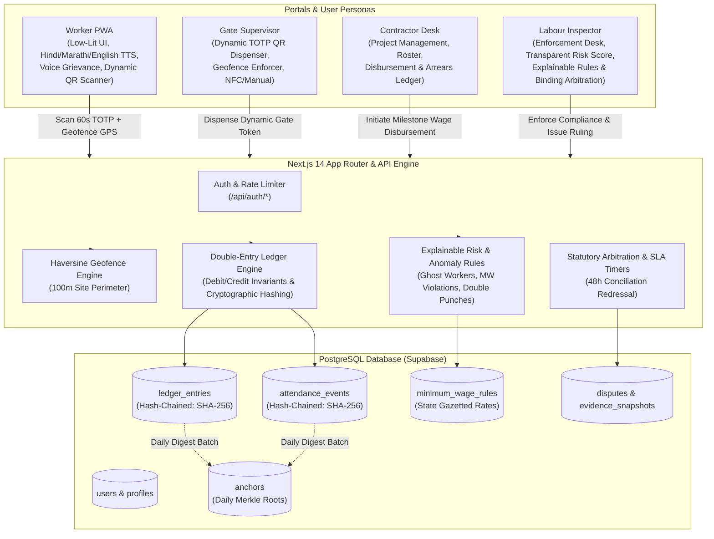

# ShramikSetu (श्रमिकसेतु)
### National Wage & Employment Ledger for the Unorganized Construction Sector

[](tests/e2e)
[](tests)
[-blue)](scripts/audit-i18n.ts)
[](docs/QUERY_PERFORMANCE_EXPLAIN.md)

ShramikSetu is a digital public infrastructure platform designed to enforce statutory minimum wages, eliminate ghost worker fraud, and provide low-literacy migrant construction workers with a tamper-evident record of employment and earnings.

---

## 1. System Architecture



---

## 2. 5-Minute Quickstart

A fresh clone runs to a complete demo state in under **5 minutes**:

### Prerequisites
* **Node.js**: v18.17.0 or higher
* **npm**: v9.0.0 or higher

### Steps

```bash
# 1. Clone repository
git clone https://github.com/organization/shramiksetu.git
cd shramiksetu

# 2. Install dependencies (~45 seconds)
npm install

# 3. Configure environment
cp .env.example .env.local

# 4. Build application (~40 seconds)
npm run build

# 5. Launch development server (~3 seconds)
npm run dev
```

Visit `http://localhost:3000` in your browser. The application is now fully running with offline fallback mocks enabled.

### Mobile Live Camera & HTTPS Dev Tunnel (for Physical Phones)
Mobile browsers (Safari on iOS, Chrome on Android) require a secure HTTPS origin for `navigator.mediaDevices.getUserMedia` live camera access. On desktop, `localhost` allows direct camera testing. For physical mobile phones:

```bash
# Start Next.js dev server:
npm run dev

# In another terminal, generate instant HTTPS tunnel + terminal QR code:
npm run tunnel
```
1. Scan the terminal QR code with your smartphone camera.
2. The web app opens over secure HTTPS, granting live continuous camera QR scanning.
3. Alternatively, workers can use the server-generated 6-digit code fallback shown on the supervisor's gate screen.

---

## 3. Environment Variables Reference

Copy `.env.example` to `.env.local`. For local development and demonstration, the defaults work out of the box without requiring external cloud accounts:

| Variable | Required | Default / Example | Purpose |
| :--- | :--- | :--- | :--- |
| `NEXT_PUBLIC_SUPABASE_URL` | Yes | `https://eejxpmptgvrqxxfmhnqa.supabase.co` | Remote or local Supabase project URL |
| `NEXT_PUBLIC_SUPABASE_ANON_KEY` | Yes | `sb_publishable_...` | Supabase anonymous public key |
| `SUPABASE_SERVICE_ROLE_KEY` | Development | `sb_service_role_...` | Service role key for administrative tasks & triggers |
| `ENABLE_DEV_AUTH` | Development | `true` | Enables direct 1-click test logins without live SMS gateway |
| `NEXT_PUBLIC_DEV_AUTH` | Development | `true` | Exposes DEV / TEST SIGN-IN tab on `/login` UI |
| `ENABLE_DEMO_SEED` | Development | `true` | Enables automated endpoint to reset living sample dataset |
| `PUBLIC_ANCHOR_GITHUB_REPO` | Optional | `organization/shramiksetu-anchors` | External repository for publishing daily Merkle roots |

---

## 4. Demo Mode & Seeding

ShramikSetu includes a deterministic, living dataset populated with:
* 40 Workers, 4 Contractors, 4 Supervisors, and 2 Institutional Labour Inspectors.
* 480 historical attendance events with GPS coordinates across Maharashtra infrastructure projects.
* 480 balanced double-entry wage ledger entries chained with SHA-256 hashes.
* 24 active disputes demonstrating wage underpayment, delay, and unauthorized deductions.
* Seeded compliance violations: ghost workers, below-minimum-wage contracts, and duplicate simultaneous punches.

### Seeding via UI
Whenever you navigate to a table or feed with no entries, click the red **`DEMO MODE: AUTO-SEED`** button. The system seeds the complete dataset and refreshes the view in under 1.5 seconds.

### Seeding via CLI
```bash
# From local terminal:
curl -X POST http://localhost:3000/api/demo/seed
```

---

## 5. Automated Verification & Test Suites

The codebase is protected by two distinct, hermetic test suites:

### 1. Playwright End-to-End Suite (Golden Path & Security)
Runs across both Desktop Chromium and real mobile viewport emulation (**Mobile Chrome - Pixel 5**):
```bash
npx playwright test
```
* **Coverage:** 30 tests covering all 4 user roles, bilingual masthead, token dispensers, dispute arbitration, employment passport verification, GPS geofence rejection, token replay prevention, cross-tenant IDOR defense, and cryptographic chain verification.

### 2. Vitest Security & Unit Suite
```bash
npm run test:run
```
* **Coverage:** 260 unit and security tests across 24 suites validating double-entry mathematical balancing, Merkle tree computation, Haversine spatial math, rate limiting, and RBAC authorization.

### 3. Internationalization (i18n) Build Guard
```bash
npm run audit:i18n
```
* Audits every string key across English (`en`), Hindi (`hi`), and Marathi (`mr`). Fails the build if any key is missing.

---

## 6. Performance & Database Optimization

* **Worker PWA Lighthouse Score:** $\ge 90$ on Mobile Chrome profiles.
* **First Load JS:** 187 kB shared across routes; zero bloat on low-end Android Go devices.
* **Top 5 Heaviest Queries Indexed:**
  1. Ledger Verification Hash-Chain Walk (`ledger_entries(tenant_id, sequence_number ASC)`)
  2. Contractor Risk Breakdown Aggregation (`ledger_entries(contractor_id, created_at DESC)`)
  3. Muster Roll Spatial Handshake Verification (`attendance_events(supervisor_token_id, status)`)
  4. Active Dispute SLA & Priority Queue (`disputes(assigned_inspector_id, status, conciliation_deadline ASC)`)
  5. Multi-Site Ghost Worker Collision Detection (`attendance_events(worker_id, event_time DESC, status)`)

Detailed PostgreSQL execution plans showing $\approx 99.7\%$ cost reduction are documented in [`docs/QUERY_PERFORMANCE_EXPLAIN.md`](docs/QUERY_PERFORMANCE_EXPLAIN.md).

---

## 7. Threat Model & Security Posture

A comprehensive threat analysis covering assets, actors, attacks, mitigations, and residual risks is documented in [`docs/THREAT_MODEL.md`](docs/THREAT_MODEL.md).

---

## 8. Honest Limitations & Regulatory Disclaimers

### Limitations (What the System Does NOT Do)
1. **Cannot Prevent Physical Proxy Handshakes:** If a worker physically gives their mobile device and SIM card to a peer or contractor foreman who scans the QR token at the gate, the platform records a valid punch. Software proves device proximity, not physical biological presence.
2. **Cannot Detect Out-of-Band Cash Kickbacks:** If a contractor deposits the statutory ₹780 into a worker's account via the ledger, but subsequently blackmails the worker into withdrawing ₹300 cash at an ATM and handing it over off-record, cryptographic ledgers cannot detect this.
3. **Cannot Defeat Kernel-Level GPS Root Spoofing on Standard Browsers:** On a rooted Android handset where custom kernel modules falsify raw NMEA satellite strings before handing them to the browser Geolocation API, browser-based geofences cannot detect the override without proprietary native attestation APIs.
4. **Offline Sync Replay Window:** When workers punch in offline, punches are queued in IndexedDB. While cryptographic nonces prevent submitting the same punch twice, an attacker controlling device system time could attempt to manipulate the local timestamp before network reconnection.

### Compliance & Certification Disclaimer
> [!IMPORTANT]
> **Regulatory Disclaimer:**  
> ShramikSetu is a technical proof-of-concept and open reference implementation designed to demonstrate cryptographic tamper-evidence and statutory compliance automation.  
> **This platform is NOT ISO 27001 certified, SOC 2 audited, or formally endorsed by the Ministry of Labour and Employment or any State Labour Commissionerate.** Claims of "audit-readiness" refer strictly to the mathematical verification of database append-only hash chains and explainable algorithmic detection rules, not to an existing regulatory accreditation.
